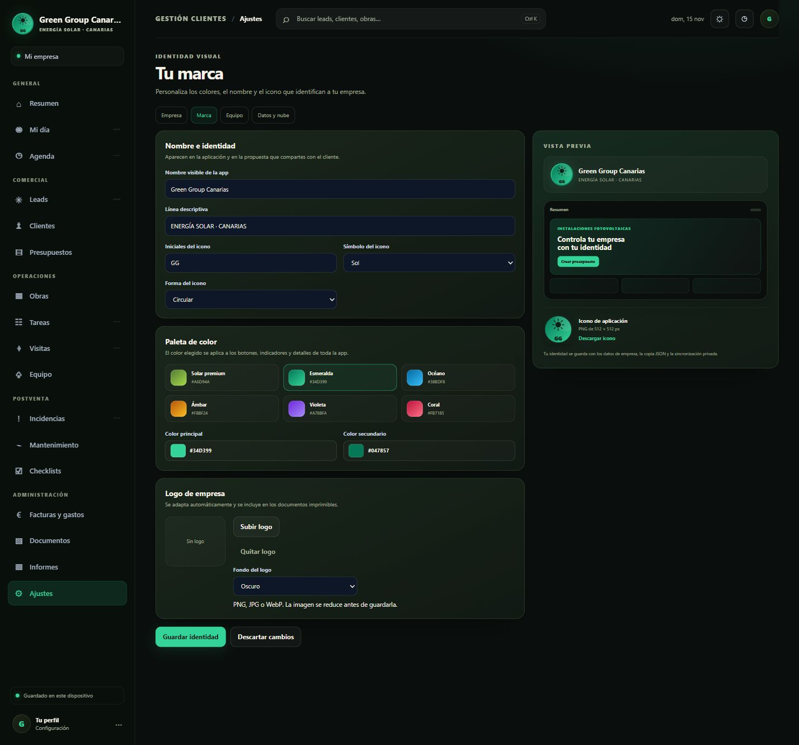
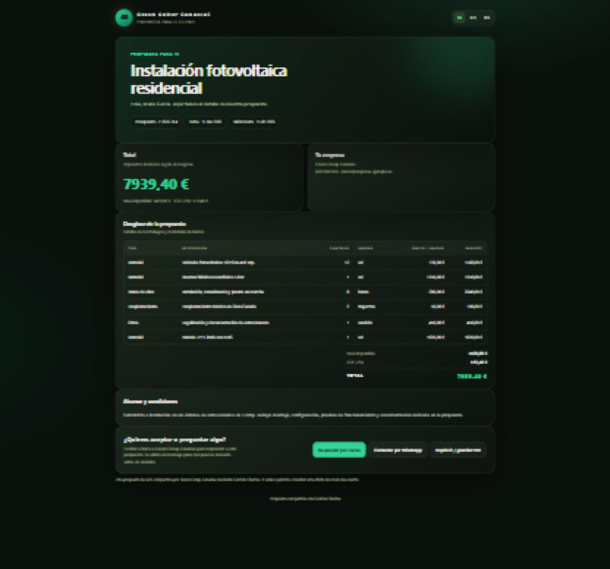

# Gestión Clientes

CRM y panel de operaciones para gestionar leads, clientes, instalaciones, presupuestos y facturas desde una sola aplicación. Está pensado para el trabajo diario de una empresa instaladora, con herramientas específicas para proyectos fotovoltaicos y la operativa fiscal de Canarias.

Gestión Clientes es un proyecto independiente de **Control Laboral**. Puede compartir el acceso a Supabase, pero guarda sus registros en `public.gestion_clientes`, separado de los datos de la otra aplicación.

## Vista general

### Identidad de empresa

Personaliza el nombre visible, la línea descriptiva, los colores, las iniciales y la forma del icono. Puedes subir el logo de tu empresa, revisar una vista previa y descargar un icono PNG de 512 × 512 px. La identidad se guarda en el dispositivo, se incluye en la copia JSON y se sincroniza con tu cuenta privada.



### Presupuestos para tus clientes

La propuesta compartida muestra la marca, los datos de la empresa, las partidas, el IGIC, las condiciones y, cuando está disponible, el estudio solar de la obra. El enlace abre una página de cliente sin necesidad de crear una cuenta.



Las capturas usan datos ficticios para enseñar la interfaz.

## Funcionalidades

### CRM y clientes

- Embudo de leads con seguimiento, responsables, valor estimado e historial de llamadas, visitas, correos, WhatsApp y notas.
- Conversión guiada de lead a cliente y, si procede, creación de su primera obra vinculada.
- Fichas relacionadas de clientes, obras, presupuestos, facturas, documentos y tareas.
- Búsqueda global, filtros por isla y vistas de lista y tablero Kanban con movimiento de tarjetas.

### Obras y equipo

- Obras con estado, fechas, avance, responsable, presupuesto y ubicación.
- Dirección, isla y coordenadas heredadas entre el lead, el cliente y la obra para reducir la entrada repetida de datos.
- Tareas, visitas, agenda, incidencias, mantenimiento y checklists conectados al trabajo.
- Acceso a la dirección y acciones rápidas para contactar al cliente.

### Instalaciones fotovoltaicas

- Estudio de producción solar por obra mediante PVGIS 5.3, con producción mensual y anual y rendimiento específico.
- Resultado solar incluido en el presupuesto y en la propuesta compartida cuando la obra tiene un estudio guardado.
- Catálogo de partidas fotovoltaicas con material, inversores, baterías, estructura, mano de obra, desplazamientos y legalización. Las cantidades y precios se pueden ajustar o guardar como tarifa propia.
- Desglose de presupuesto con horas, trayectos, materiales, base imponible, IGIC y total. Se puede imprimir o guardar como PDF.
- Importación de la tarifa o factura de compra de Coelca en **Ajustes → Costes Coelca**. Los costes se guardan sin IGIC (la app puede descontarlo al importar), se reutilizan en partidas de presupuestos y permanecen separados del precio de venta.
- Cálculo visible por partida de venta, coste directo y beneficio bruto, además del resumen de margen del presupuesto. Los importes aceptan decimales en formato español; la app avisa si falta un coste y nunca incluye los costes internos en facturas, propuestas ni PDF para clientes.
- La tarifa profesional de Coelca depende de cada cuenta y no se inventa: importa el CSV de compra o usa la plantilla para cargarla una sola vez. Los precios públicos o referencias de mercado no sustituyen tu coste real negociado.

### Administración y marca

- Facturas, vencimientos, pagos parciales, cobros pendientes y gastos asociados a las obras.
- Exportación CSV, copias de seguridad JSON, restauración y uso local sin conexión.
- Modos oscuro y claro y personalización de la marca para la app, los documentos imprimibles y las propuestas de cliente.
- IGIC general de Canarias como tipo inicial; el porcentaje se puede modificar para cada operación.

## Descarga e instalación

La paleta, el icono y el logo están a mano en **Administración → Marca** (también en la pestaña **Marca** de Ajustes). El icono compacto se muestra en la barra lateral; el logo completo se conserva para presupuestos, facturas y propuestas.

| Plataforma | Descarga o acceso |
| --- | --- |
| Web / PWA | [Abrir Gestión Clientes](https://ivory37goku.github.io/gestion-clientes/) |
| Android | [Descargar APK 1.0.20](https://raw.githubusercontent.com/Ivory37goku/gestion-clientes/main/downloads/gestion-clientes-1.0.20.apk) |
| Windows | [Abrir las compilaciones de Windows](https://github.com/Ivory37goku/gestion-clientes/actions/workflows/windows.yml) |

En Android, descarga el APK e instálalo desde el dispositivo. En Windows, abre la última ejecución correcta del workflow y descarga el artefacto `gestion-clientes-windows`, que contiene el instalador y la versión portable. La PWA también se puede añadir a la pantalla de inicio desde el navegador.

La app busca actualizaciones automáticamente y las aplica cuando no hay cambios pendientes en los formularios.

## Sincronización privada

En **Ajustes → Datos y nube**, inicia sesión con la misma cuenta que usas en Control Laboral. Ejecuta una vez el archivo SQL que proporciona la app para crear la tabla privada `public.gestion_clientes` en tu proyecto Supabase.

La tabla pertenece solo a Gestión Clientes. No sustituye ni modifica `public.ivory37_sync`. Si no hay conexión o no usas una cuenta, los datos siguen guardándose localmente y puedes moverlos mediante una copia JSON.

Para que las invitaciones y confirmaciones de Supabase regresen a la app, añade la dirección de GitHub Pages a **Authentication → URL Configuration** del proyecto.

## Compilar desde el código

### PWA

Abre `index.html` con un servidor estático para desarrollo. El workflow de GitHub Pages publica la aplicación en [ivory37goku.github.io/gestion-clientes](https://ivory37goku.github.io/gestion-clientes/).

### APK Android

Con Java 17 y Android SDK disponibles, ejecuta desde `android-app`:

```powershell
.\gradlew.bat assembleDebug
```

Antes de compilar, Gradle sincroniza la versión web actual con los recursos de Android. El APK se genera en `android-app/app/build/outputs/apk/debug/app-debug.apk`.

### Windows

Con Node.js instalado, ejecuta desde la raíz:

```powershell
npm ci
npm run dist:win
```

El instalador NSIS y la aplicación portable se crean en `desktop-dist`. El workflow de Windows los publica como artefactos de cada compilación de `main`.

## Estructura del proyecto

| Ruta | Contenido |
| --- | --- |
| `index.html`, `app.js`, `styles.css` | Aplicación web y PWA |
| `cliente.html` | Página pública de las propuestas compartidas |
| `supabase-config.js` | Configuración de conexión a Supabase; no contiene contraseñas de usuarios |
| `android-app/` | Contenedor Android y proceso de sincronización de recursos web |
| `desktop/` | Aplicación Windows con Electron |
| `downloads/` | APK Android de descarga directa |
| `screenshots/` | Capturas reales de la interfaz incluidas en este README |
| `.github/workflows/` | Publicación de Pages y compilaciones Android y Windows |

## Tecnologías

PWA con HTML, CSS y JavaScript, almacenamiento local, service worker y sincronización opcional mediante Supabase. Android se empaqueta con WebView y la aplicación de escritorio con Electron.
